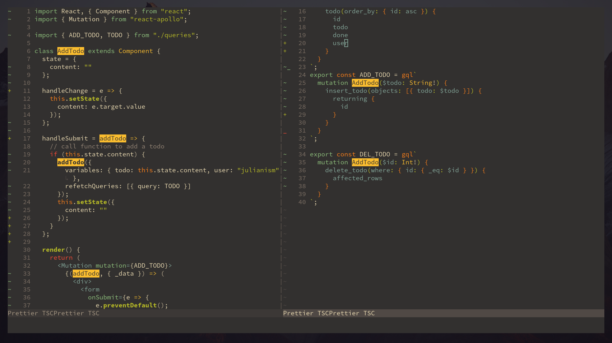
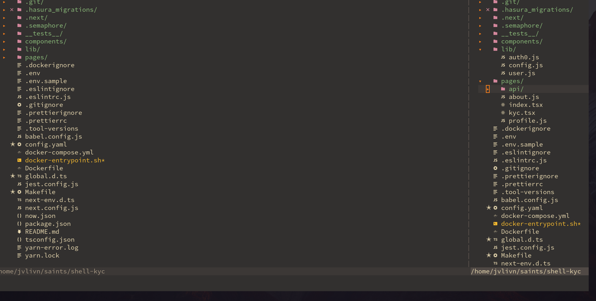

# tuldok.vim
## My own vim setup

Inspired by 
https://github.com/rstacruz/vim-from-scratch

# Screenshot






### Setting UP

#### Install VIM 


## Install Vim and Neovim <a id='install'></a>

> (Skip this step if you've already installed Vim.)

There are many ways to acquire Vim. I suggest using [Neovim], a fork of Vim with extra features--but regular [Vim] would work just fine.

- **Vim on Linux** <br> Most distributions come with `vim` and `neovim` packages. Some distributions have different versions available. When in doubt, pick the `vim-gnome` or `vim-gtk3` or `gvim` package.

  ```bash
  sudo pacman -S gvim         # Arch Linux
  sudo apt install vim-gnome  # Ubuntu
  ```

- **Neovim on Linux** <br> If your distro ships with python-neovim, add it in too.

  ```bash
  sudo pacman -S neovim python-neovim
  ```

- **Neovim on MacOS** <br> The `neovim` package is available in [Homebrew].

  ```bash
  brew install neovim
  # (todo: add more notes on python integration etc)
  ```

- **Vim on MacOS** <br> I recommend using [Macvim] with installed via [Homebrew] with `--override-system-vim`. This gets you a more updated version of Vim than if you used the `vim` package. You'll also get a GUI app, which can be nice.

  ```bash
  brew install macvim --with-cscope --with-lua --override-system-vim --with-luajit --with-python3
  ```


#### Install Plug 
```bash
curl -fLo ~/.vim/autoload/plug.vim --create-dirs \
  https://raw.githubusercontent.com/junegunn/vim-plug/master/plug.vim
```

## Back up your existing Vim config <a id='backup'></a>

> (Skip this step if you're setting up a fresh installation of Vim.)

Want to try out this guide, but you already have Vim set up? You can rename them for now, and restore it later on.

```bash
mv ~/.vimrc ~/.vimrc~
mv ~/.vim ~/.vim~
mv ~/.config/nvim ~/.config/nvim~
```


## Clone repository 
git clone git@github.com:sbpipb/tuldok.vim.git ~/.vim

### Run make link
